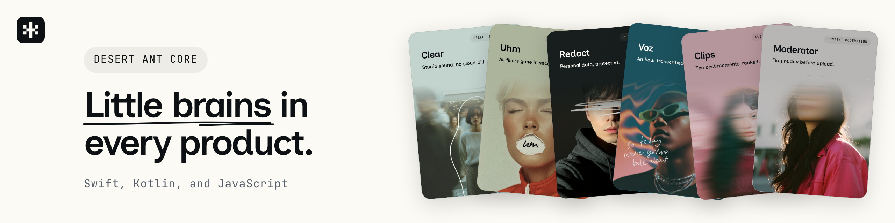

# Desert Ant Core


Add on-device speech recognition, audio cleanup, PII redaction, emoji suggestion, and more to your app, with SDKs for Swift, Kotlin, and JavaScript. The models run on the device, so text, audio, and images never leave it.

```swift
import Emo
import Redact

let suggestions = try await Emo().suggestions(for: "Pay my bills")   // 💰 💳 🧾
let clean = try await Redact().redaction(of: "Email Anna at anna@example.hu.")
// Email [GIVEN_NAME_1] at [EMAIL_1].
```

- [Models](#models)
- [Swift](#swift)
- [Android](#android)
- [JavaScript and TypeScript](#javascript-and-typescript)
- [Command line](#command-line)
- [Model downloads and caching](#model-downloads-and-caching)
- [Other notes](#other-notes)
- [License](#license)

## Models

<!-- models:start -->
| Model | What it does | Platform | Docs |
| --- | --- | --- | --- |
| **Align** | Word-timestamp refinement for any transcript, on device. | Apple · Linux · Windows · Node | [SDK](https://github.com/Desert-Ant-Labs/desert-ant-core/blob/main/docs/models/align.md) [Model](https://huggingface.co/desert-ant-labs/align) |
| **Clear** | On-device speech enhancement: denoise, dereverb, and loudness-normalize. | Apple · Android · Linux · Windows · Web · Node | [SDK](https://github.com/Desert-Ant-Labs/desert-ant-core/blob/main/docs/models/clear.md) [Model](https://huggingface.co/desert-ant-labs/clear) |
| **Clips** | Short clips and highlights from talking video and audio: podcasts, interviews, meetings. On-device. | Apple · Linux · Windows | [SDK](https://github.com/Desert-Ant-Labs/desert-ant-core/blob/main/docs/models/clips.md) [Model](https://huggingface.co/desert-ant-labs/clips) |
| **Ear** | On-device spoken language identification across 102 languages. | Apple · Android · Linux · Windows · Web · Node | [SDK](https://github.com/Desert-Ant-Labs/desert-ant-core/blob/main/docs/models/ear.md) [Model](https://huggingface.co/desert-ant-labs/ear) |
| **Emo** | Multilingual on-device emoji suggestion. | Apple · Android · Linux · Windows · Web · Node | [SDK](https://github.com/Desert-Ant-Labs/desert-ant-core/blob/main/docs/models/emo.md) [Model](https://huggingface.co/desert-ant-labs/emo) |
| **Eye** | On-device photo understanding: scenes, quality, faces, people, pets, crops and sharpness. | Apple · Android · Linux · Windows · Web · Node | [SDK](https://github.com/Desert-Ant-Labs/desert-ant-core/blob/main/docs/models/eye.md) [Model](https://huggingface.co/desert-ant-labs/eye) |
| **Gist** | Multilingual on-device content topic tagging across a 36-topic taxonomy. | Apple · Android · Linux · Windows · Web · Node | [SDK](https://github.com/Desert-Ant-Labs/desert-ant-core/blob/main/docs/models/gist.md) [Model](https://huggingface.co/desert-ant-labs/gist) |
| **Moderator** | On-device NSFW image detection, trained only on licensed and synthetic data. | Apple · Android · Linux · Windows · Web · Node | [SDK](https://github.com/Desert-Ant-Labs/desert-ant-core/blob/main/docs/models/moderator.md) [Model](https://huggingface.co/desert-ant-labs/moderator) |
| **Redact** | Multilingual on-device PII detection and redaction. | Apple · Android · Linux · Windows · Web · Node | [SDK](https://github.com/Desert-Ant-Labs/desert-ant-core/blob/main/docs/models/redact.md) [Model](https://huggingface.co/desert-ant-labs/redact) |
| **Shapes** | On-device single-stroke shape recognition. | Apple · Android · Linux · Windows · Web · Node | [SDK](https://github.com/Desert-Ant-Labs/desert-ant-core/blob/main/docs/models/shapes.md) [Model](https://huggingface.co/desert-ant-labs/shapes) |
| **Title** | On-device titles and descriptions: a short factual title and a one- to two-sentence description for any passage of text. | Apple | [SDK](https://github.com/Desert-Ant-Labs/desert-ant-core/blob/main/docs/models/title.md) [Model](https://huggingface.co/desert-ant-labs/title) |
| **Tongue** | On-device language identification for short text across 84 languages. | Apple · Android · Linux · Windows · Web · Node | [SDK](https://github.com/Desert-Ant-Labs/desert-ant-core/blob/main/docs/models/tongue.md) [Model](https://huggingface.co/desert-ant-labs/tongue) |
| **Uhm** | On-device filler-word detection: frame-precise "uh"/"um"/"hmm" spans. | Apple | [SDK](https://github.com/Desert-Ant-Labs/desert-ant-core/blob/main/docs/models/uhm.md) [Model](https://huggingface.co/desert-ant-labs/uhm) |
| **Voz** | On-device speech recognition: transcripts with word-level timestamps, 25 languages. | Apple · Android · Linux · Windows · Web · Node | [SDK](https://github.com/Desert-Ant-Labs/desert-ant-core/blob/main/docs/models/voz.md) [Model](https://huggingface.co/desert-ant-labs/voz) |
| **Who** | On-device speaker labeling: per-person turns with timestamps. | Apple · Android · Linux · Windows · Web · Node | [SDK](https://github.com/Desert-Ant-Labs/desert-ant-core/blob/main/docs/models/who.md) [Model](https://huggingface.co/desert-ant-labs/who) |

### In closed beta

Weights exist and the models work, but no SDK ships them yet, so there is
nothing to install today. Ask us if you want early access.

| Model | What it does | Docs |
| --- | --- | --- |
| **Face** | On-device face matching across a photo library or through a video. | [Model](https://huggingface.co/desert-ant-labs/face) |
| **Schemer** | On-device structured extraction into a caller-supplied JSON schema. | [Model](https://huggingface.co/desert-ant-labs/schemer) |
| **Toxic** | On-device hate-speech triage for European languages. | [Model](https://huggingface.co/desert-ant-labs/toxic) |
<!-- models:end -->

The weights for every model are on [Hugging Face](https://huggingface.co/desert-ant-labs).

## Swift

On Apple platforms, the Swift package requires iOS 18+, macOS 15+, tvOS 18+, visionOS 2+, and Swift 6.2+ (Xcode 26). An older OS can't load the Core ML models. On Windows, the Swift package requires x64 and Swift 6.2+.

Add the package with Swift Package Manager:

```swift
.package(url: "https://github.com/Desert-Ant-Labs/desert-ant-core.git", from: "4.2.3")
```

Then add a product for each model you use, such as `Emo`. Your app includes only the models you add.

## Android

The Android SDK requires API 24+ and runs on arm64-v8a and x86_64. All models share one copy of LiteRT from `ai.desertant:core`, so each model you add brings only its own native library.

```kotlin
// settings.gradle.kts
dependencyResolutionManagement {
    repositories {
        google()
        mavenCentral()
    }
}

// build.gradle.kts
dependencies {
    implementation("ai.desertant:emo:4.2.3")
    implementation("ai.desertant:redact:4.2.3")
    implementation("ai.desertant:clear:4.2.3")
    implementation("ai.desertant:tongue:4.2.3")
}
```

Tongue has no native code, so you can also use Tongue outside Android, on any JVM 17+.

## JavaScript and TypeScript

Each model is its own package, so install the ones you use:

```bash
# Browser (WebAssembly + LiteRT.js):
npm i @desert-ant-labs/emo @litertjs/core

# Server-side inference in Node (prebuilt native core, no extra install):
npm i @desert-ant-labs/emo

# Tongue is pure JavaScript, no wasm, no LiteRT.js, no native core:
npm i @desert-ant-labs/tongue
```

The default import is the browser build. The browser build has no native dependencies, so Next.js, Remix, SvelteKit, and Nuxt can bundle it for every target, including the server-side rendering pass. For inference in plain Node, import the `/native` subpath. `/native` ships prebuilt for linux-x64, linux-arm64, and darwin-arm64. Voz has no `/native` subpath. In Node, pass `onnxruntime-node` to Voz's `load()`.

Align runs only in Node. You can still import `@desert-ant-labs/align` anywhere, including the server-side rendering pass. Calling `load()` from that import throws an error that tells you to import `@desert-ant-labs/align/native` instead.

## Command line

Transcribe a recording, cut clips, clean up audio, or redact text from the terminal. The [Desert Ant CLI](https://github.com/Desert-Ant-Labs/desert-ant-cli) runs on macOS (Apple silicon) and Linux:

```bash
curl -fsSL https://raw.githubusercontent.com/Desert-Ant-Labs/desert-ant-cli/main/install.sh | sh
```

You can also install the CLI with `brew install desert-ant-labs/tap/desertant` or with mise. Then run a model:

```
$ da redact "Email Anna at anna@example.hu or call 555-0100"
Email [GIVEN_NAME_1] at [EMAIL_1] or call [PHONE_1]
```

Commands pass JSON to each other, so you can transcribe a video once and cut clips from that transcript.

`desertant setup` writes a skill so coding agents on your machine, such as Claude Code and Codex, can use the CLI.

## Model downloads and caching

The SDK downloads each model from [Hugging Face](https://huggingface.co/desert-ant-labs) on first use. The models are public, so the download needs no Hugging Face account or token. Each SDK version pins one model revision, so your app gets the same model until you update the SDK. The SDK verifies every download before using it. Tongue's 2MB model ships inside each package, so Tongue never downloads anything.

- By default, the SDK keeps the files in the platform cache directory and reuses them across launches.
- Pass `directory` to keep the model in your own folder. If the model files are already in the folder, the SDK uses them and downloads nothing. Otherwise the SDK downloads the model into the folder.
- On the web, you can serve the files yourself and pass `modelBaseUrl`.

`isDownloaded()` tells you whether a model works with no network. `download()` fetches the model ahead of time and reports progress.

`HF_TOKEN` is optional. When the environment sets `HF_TOKEN`, the SDK sends the token to Hugging Face, and Hugging Face allows more downloads per hour. Leave `HF_TOKEN` unset unless downloads hit Hugging Face's rate limit.

### Faster downloads on Apple platforms (the `Xet` trait)

Our Hugging Face repos use [Xet](https://huggingface.co/docs/hub/en/xet/index) storage, which splits each file into deduplicated chunks that download in parallel instead of as one stream. On Apple platforms, the Swift package can download through Xet when you turn on a package trait:

```swift
.package(url: "https://github.com/Desert-Ant-Labs/desert-ant-core.git", from: "4.2.3",
        traits: ["Xet"])
```

With the trait on, the same files land in the same cache, and the SDK verifies them the same way. If a file isn't on Xet, or the Xet download fails, the SDK falls back to the ordinary HTTPS download. The trait adds [swift-xet](https://github.com/huggingface/swift-xet) and SwiftNIO to your dependencies. Every other platform and SDK downloads over plain HTTPS.

## Other notes

- [Offline](docs/notes/offline.md)
- [AWS Lambda on arm64](docs/notes/aws-lambda-arm64.md)
- [Faster first load on the M6 and A20 Pro](docs/notes/faster-first-load-m6-a20-pro.md)

## License

[Desert Ant Labs Source-Available License](https://license.desertant.com/). Most apps can use the SDK for free. At scale, you need a commercial license. The link has the full terms. For licensing, email <licensing@desertant.com>. [THIRD_PARTY_NOTICES.md](THIRD_PARTY_NOTICES.md) lists the third-party components.
